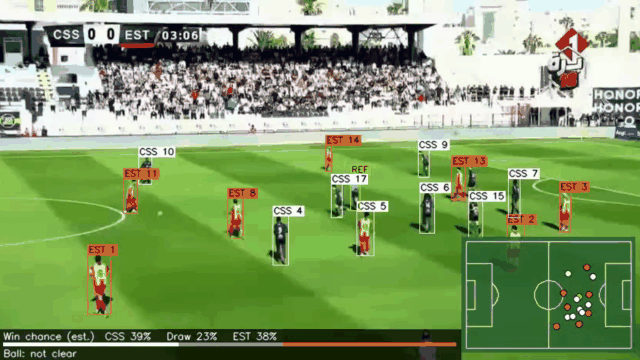

# Marsad

<p align="center">
  <a href="assets/demo.mp4"></a>
</p>

**[▶ Voir la présentation du projet sur LinkedIn](https://www.linkedin.com/feed/update/urn:li:activity:7524871720399257601/)**

[English](README.md) | **Français**

Pipeline de vision par ordinateur qui analyse les vidéos de diffusion des matchs de Ligue 1
tunisienne : détection et suivi des joueurs, identification des équipes et carte tactique 2D du
terrain.

## Présentation

Les données de suivi (positions des joueurs, bloc d'équipe, distances de pressing) sont courantes
dans les grands championnats européens, mais presque inexistantes pour le football tunisien, dont
la plupart des matchs n'existent qu'en vidéo de diffusion TV.

Marsad part de cette vidéo : il détecte les personnes sur le terrain (YOLOv8), leur attribue un
identifiant stable (BoT-SORT + OSNet + RobustMapper), distingue les deux équipes et l'arbitre par
la couleur des maillots, puis projette chacun sur une vue du terrain vue de dessus grâce à une
homographie calculée image par image.

La précision du suivi (HOTA) n'a pas encore été mesurée, faute de jeu de données annoté.

## Installation

Python 3.11, GPU NVIDIA recommandé.

```bash
git clone https://github.com/anis-mselmi/Marsad.git
cd Marsad
python3.11 -m venv .venv            # Windows : py -3.11 -m venv .venv
source .venv/bin/activate           # Windows : .venv\Scripts\activate
pip install torch torchvision --index-url https://download.pytorch.org/whl/cu128
pip install -r requirements.txt
```

## Utilisation

Utilisez votre propre vidéo : aucune vidéo de match n'est fournie dans ce dépôt.

```bash
# Détection, suivi, équipes, comptage par zone
python scripts/run_pipeline.py --video chemin/vers/match.mp4 --out-dir results/match

# Avec la carte 2D et le bandeau inférieur
python scripts/run_pipeline.py --video chemin/vers/match.mp4 --out-dir results/match \
    --match ess_css --calibration configs/calibration/ess_css_clip.yaml
```

Fichiers produits : `annotated.mp4`, `tracks.txt` (format MOT), `counts.csv`, `counts.json` et
`summary.json`. Voir le [README anglais](README.md) pour la configuration détaillée.

## Avertissement

Projet indépendant, sans lien avec la Ligue Professionnelle de Football ni avec aucun club. Les
utilisateurs sont responsables du respect des droits de diffusion et des droits vidéo. Aucun
contenu vidéo n'est distribué dans ce dépôt.

## Auteur

**Anis Mselmi**, ingénieur IA et étudiant en génie informatique à l'École Polytechnique de Sousse.
[GitHub](https://github.com/anis-mselmi) · [LinkedIn](https://www.linkedin.com/in/anis-mselmi-441b39326)
