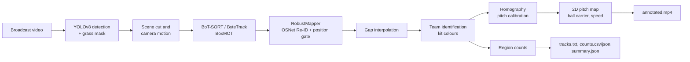

# Marsad

<video src="assets/demo.mp4" controls autoplay muted loop width="100%"></video>

<!-- GitHub only plays videos it hosts itself. In the GitHub web editor, drag assets/demo.mp4 onto
     this README and replace the <video> line above with the https://github.com/user-attachments/...
     URL that GitHub inserts. -->

**[▶ Watch the project presentation on LinkedIn](https://www.linkedin.com/feed/update/urn:li:activity:7524871720399257601/)**

**English** | [Français](README.fr.md)

A computer vision pipeline that analyzes Tunisian Ligue 1 broadcast match videos: player detection and tracking, team identification, and a 2D tactical pitch map.


<!-- TODO: add a license badge once a LICENSE file is chosen and committed -->

*Demo: detections labelled by team and ID, the 2D pitch map in the bottom-right corner, and the bottom strip with the ball carrier.*

## Overview

Tracking data such as player positions, team shape and pressing distances is standard in the
top European leagues, but it is rarely available for Tunisian football. Most Ligue 1 matches exist
only as TV broadcasts.

Marsad starts from that broadcast video. It finds the people on the pitch, keeps a stable ID for
each one, tells the two teams and the referee apart from their kit colours, and projects everyone
onto a top-down pitch so the match can be read tactically.

## Features

- **Player detection**: YOLOv8 (Ultralytics) with a grass mask that drops people whose feet are off
  the pitch (crowd, bench, photographers, ad boards).
- **Tracking with stable IDs**: BoT-SORT or ByteTrack via BoxMOT, followed by *RobustMapper*, which
  turns raw tracker IDs into stable identities using OSNet appearance embeddings, position gating
  and camera motion compensation.
- **Scene cut handling**: broadcast cuts are detected and reset the tracker; re-identification
  across a cut uses a much stricter appearance threshold.
- **Team identification**: each identity's torso colour (Lab chroma) is matched against the kits
  of the two clubs in `configs/teams.yaml`. Off-kit identities are labelled referee, and people who
  stay at the bottom edge of the frame are dropped as staff.
- **2D tactical map**: a per-frame homography from hand-marked landmarks, refined against the white
  pitch lines and followed through camera pans and zooms.
- **Match strip**: ball detection, ball carrier and running speed in km/h from the pitch map, plus
  an *illustrative* win-chance bar (not a prediction, nothing is fitted to match data).
- **Region counting**: number of players inside configurable polygons, per frame.
- **Evaluation tooling**: TrackEval wrapper (HOTA, DetA, AssA, IDF1, ID switches), baseline and
  ablation runners, dataset converters for MOT and SoccerNet layouts, and a detector fine-tuning
  script.

## How it works



1. **Detection**: YOLOv8m at 1920 px, low confidence threshold so trackers can use weak boxes.
   A grass mask in HSV keeps only people standing on the pitch.
2. **Scene cuts and camera motion**: a cut is detected when most pixels change at once. Otherwise a
   similarity transform is estimated from background features (optical flow, RANSAC) so remembered
   positions move with the camera.
3. **Tracking**: BoT-SORT (with global motion compensation and Re-ID) or ByteTrack, through BoxMOT.
4. **RobustMapper** (`src/track/robust_mapper.py`):
   - a new ID stays tentative until it survives 8 frames, then its earlier frames are backfilled;
   - each identity keeps a gallery of up to 50 diverse OSNet embeddings;
   - a lost identity is restored only if appearance and position agree, the match is unambiguous,
     and the two tracks were never on screen together.
5. **Clean-up**: short gaps are interpolated, never across a cut.
6. **Team identification** (`src/detect/kit_roles.py`): median torso colour per identity, nearest
   kit wins. Per-clip manual corrections (`identities`, `moves`) are supported in `teams.yaml`.
7. **Pitch calibration** (`src/pitch/calibration.py`): anchors are tightened against detected white
   lines, then the homography is propagated frame by frame and smoothed.
8. **Outputs**: annotated video, MOT tracks, region counts and a run summary.

All thresholds live in `configs/`.

## Tech stack

| Component | Library / model |
|---|---|
| Detection | [Ultralytics](https://github.com/ultralytics/ultralytics) YOLOv8m, COCO pretrained |
| Tracking | [BoxMOT](https://github.com/mikel-brostrom/boxmot): BoT-SORT, ByteTrack |
| Re-identification | OSNet `osnet_x0_25_msmt17` (via BoxMOT) |
| Deep learning runtime | PyTorch, torchvision (CUDA 12.8 wheels) |
| Image processing, camera motion, homography | OpenCV |
| Calibration fitting | SciPy (`least_squares`) |
| Evaluation | [TrackEval](https://github.com/JonathonLuiten/TrackEval) |
| Data, plots, config | NumPy, pandas, Matplotlib, PyYAML |
| Tests | pytest |

## Project structure

<details>
<summary>Annotated file tree</summary>

```
Marsad/
├── configs/
│   ├── calibration/         # hand-marked pitch landmarks, one file per clip
│   ├── data.yaml            # dataset layout, class names, split
│   ├── detector.yaml        # YOLO inference, grass mask, fine-tuning settings
│   ├── eval.yaml            # TrackEval thresholds
│   ├── match_stats.yaml     # ball, carrier, speed, illustrative win chances
│   ├── pitch.yaml           # pitch dimensions, calibration and map style
│   ├── regions.yaml         # counting polygons
│   ├── render.yaml          # annotated video style
│   ├── robust_mapper.yaml   # stable-ID rules
│   ├── teams.yaml           # Ligue 1 clubs, kit colours, per-match settings
│   └── tracker.yaml         # BoT-SORT / ByteTrack, Re-ID, camera, kit roles
├── scripts/
│   ├── run_pipeline.py      # main entry point: video in, outputs out
│   └── download_soccernet.sh
├── src/
│   ├── analysis/            # ball detection, carrier, speed, win chances
│   ├── count/               # region counting
│   ├── data/                # MOT loader, dataset converters, synthetic data
│   ├── detect/              # YOLO inference, kit-colour roles, training, model comparison
│   ├── eval/                # TrackEval wrapper, baselines and ablations
│   ├── pitch/               # pitch template and per-frame calibration
│   ├── track/               # tracker wrapper, camera motion, Re-ID, RobustMapper
│   ├── viz/                 # video rendering, pitch map, bottom strip
│   └── pipeline.py          # core tracking loop
├── tests/                   # pytest suite
├── results/                 # run outputs (videos are git-ignored)
├── Makefile
└── requirements.txt
```

</details>

## Getting started

### Prerequisites

- Python 3.11
- An NVIDIA GPU with CUDA is recommended (developed on an RTX 3050, 6 GB)
- Git (TrackEval is installed from GitHub)

### Installation

```bash
git clone https://github.com/anis-mselmi/Marsad.git
cd Marsad
python3.11 -m venv .venv            # Windows: py -3.11 -m venv .venv
source .venv/bin/activate           # Windows: .venv\Scripts\activate

# PyTorch first, from the CUDA index
pip install torch torchvision --index-url https://download.pytorch.org/whl/cu128
pip install -r requirements.txt
```

YOLOv8 weights (`yolov8m.pt`) and OSNet weights are downloaded automatically on first run.

### GPU / CPU notes

- The configs target a GPU: `device: 0` in `configs/detector.yaml` and `device: cuda:0` in
  `configs/tracker.yaml`. For CPU, set them to `cpu` and set `half: false`. Expect it to be slow at
  `imgsz: 1920`.
- If PyTorch reports an OpenMP clash on Windows, set `KMP_DUPLICATE_LIB_OK=TRUE`.

### Tests

```bash
python -m pytest
```

## Usage

Bring your own video. No match footage is distributed with this repository.

**Basic run** (detection, tracking, teams, region counts):

```bash
python scripts/run_pipeline.py --video path/to/match.mp4 --out-dir results/match
```

**With the 2D pitch map and bottom strip**:

```bash
python scripts/run_pipeline.py --video path/to/match.mp4 --out-dir results/match \
    --match ess_css --calibration configs/calibration/ess_css_clip.yaml
```

| Argument | Default | Purpose |
|---|---|---|
| `--video` | required | Input video (any format OpenCV can read, e.g. `.mp4`) |
| `--out-dir` | required | Output folder |
| `--match` | none | Entry under `matches` in `configs/teams.yaml` (kits, manual fixes, score info) |
| `--calibration` | none | Landmark file; enables the pitch map |
| `--detector-config`, `--tracker-config`, `--mapper-config`, `--regions-config`, `--render-config`, `--teams-config`, `--pitch-config`, `--stats-config` | files in `configs/` | Swap any config by name or path |

**Outputs** in `--out-dir`:

| File | Content |
|---|---|
| `annotated.mp4` | Boxes labelled by team and ID, optional pitch map and bottom strip |
| `tracks.txt` | MOT format: `frame, id, x, y, w, h, conf, class, visibility` |
| `counts.csv`, `counts.json` | Players per region, per frame |
| `summary.json` | Frames, processing speed, raw vs stable ID counts, scene cuts, roles |

<details>
<summary>Configuring a new match</summary>

1. In `configs/teams.yaml`, add an entry under `matches` with the two club codes and, if needed,
   kit colours measured on your footage (Lab values on OpenCV's 0-255 scale).
2. For the pitch map, create `configs/calibration/<clip>.yaml` with one anchor per shot: a frame
   number (1-based) and a few landmarks with `pixel: [x, y]` and `pitch: [x, y]` in metres (origin
   at the centre spot). Use line crossings and box corners. See the existing files for examples.
3. Edit `configs/regions.yaml`: the polygons there are examples for 832x464 video.

</details>

<details>
<summary>Training and evaluation with a labelled dataset</summary>

```bash
bash scripts/download_soccernet.sh <target_dir>                      # SoccerNet-Tracking 2023
python -m src.data.converters --source <path> --format soccernet     # or: --format mot
python -m src.detect.train                                           # fine-tune YOLO
python -m src.detect.compare --dataset-yaml data/yolo/dataset.yaml   # compare detectors
python -m src.eval.run_trackeval --gt-root data/val --gt-as-tracker  # self-check, HOTA must be 100
make baselines
make ablation
```

After fine-tuning, set `inference.weights` and `inference.class_map` in `configs/detector.yaml`.
Note that `training.export_dir` in that file must point to a folder on your machine.

</details>

## Results and limitations

Results so far are qualitative. No labelled Tunisian Ligue 1 dataset was available, so **tracking
accuracy (HOTA) has not been measured** and the detector is the pretrained COCO model, not
fine-tuned.

Measured behaviour on the test clips is recorded in `results/`:

- On an 832x464 broadcast clip of 328 frames, the full pipeline ran at 5.8 frames per second on an
  RTX 3050 (6 GB). RobustMapper reduced the raw BoT-SORT + OSNet output from 123 to 61 unique IDs.
- On the CSS vs EST clip, on average 90% of projected pitch markings landed within 3 px of a white
  line (worst frame 60%). This is one clip, not a general accuracy figure.

> **Placeholder:** HOTA / IDF1 on a labelled dataset — not yet measured.

Known limitations, from the code and the test clips:

- **Occlusions and crowded contact**: players grappling close together get merged or missed boxes.
- **Camera cuts and replays**: most IDs restart after a cut; in identical kits, appearance alone
  cannot safely link people across it.
- **ID swaps**: if a raw track jumps between two people, RobustMapper cannot undo it. Per-clip
  manual fixes exist in `teams.yaml` for this reason.
- **Similar kits**: team assignment uses torso colour only. It assumes a green pitch and two
  distinct kits, and cannot tell a goalkeeper from a referee without a fine-tuned detector.
- **Homography**: calibration needs hand-marked anchors for every shot. Far landmarks (corner flags)
  are the least reliable, and smoke, haze or few visible lines degrade the fit.
- **Region counting** uses fixed pixel polygons, which do not follow the camera.
- **Thresholds** were tuned by eye on a few clips and may need adjusting for other footage.
- **Win chances** in the bottom strip are illustrative only, based on hand-set club strengths.
- The SoccerNet converter, `train.py` and `compare.py` have not been run on real data yet.

## Roadmap

**Done**
- [x] Detection with pitch filtering
- [x] BoT-SORT / ByteTrack tracking with scene cut handling and camera motion
- [x] RobustMapper stable IDs with OSNet Re-ID
- [x] Team identification from Ligue 1 kit colours
- [x] Per-frame pitch calibration and 2D map
- [x] Ball carrier, speed and match strip
- [x] TrackEval wrapper, baselines and ablation runners
- [x] Test suite

**In progress**
- [ ] Labelled dataset and HOTA measurement

**Planned**
- [ ] Fine-tuned detector with player / goalkeeper / referee classes
- [ ] Automatic pitch keypoint detection instead of hand-marked anchors
- [ ] Regions pinned to the pitch through the per-frame homography
- [ ] Tactical exports (heatmaps, team shape)

## Contributing

Issues and pull requests are welcome.

- Open an issue first for larger changes.
- Keep thresholds in `configs/`, not in code.
- Add or update tests in `tests/` and run `python -m pytest` before opening a PR.
- Do not commit match videos, club logos or model weights.

## Legal and disclaimer

Independent project, not affiliated with the Ligue Professionnelle de Football or any club. Users
are responsible for complying with broadcast and video rights. No video content is distributed in
this repository.

## License and author

License: *to be decided* <!-- TODO: add LICENSE file (MIT or Apache-2.0) -->

**Anis Mselmi**, AI Engineer and computer engineering student at École Polytechnique de Sousse.

[GitHub](https://github.com/anis-mselmi) · [LinkedIn](https://www.linkedin.com/in/anis-mselmi-441b39326)
